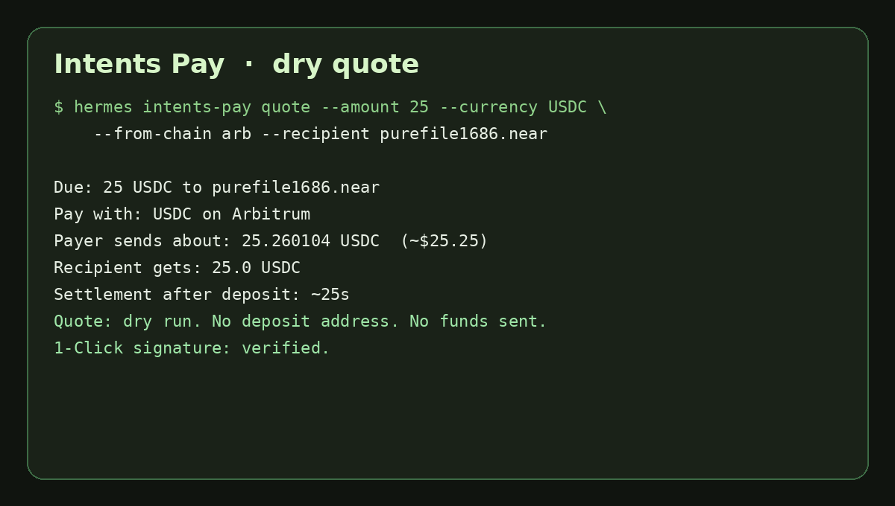

# Intents Pay

Hermes Agent plugin that prices and invoices a cross-chain payment to a NEAR account through the [NEAR Intents 1-Click API](https://docs.near-intents.org). Hermes can list supported tokens, dry-run a quote, write a shareable invoice card, check a deposit, and verify the quote signature locally.

It does not broadcast a transaction, and it does not ask for or store a seed phrase or signing key. Quotes are dry unless the user confirms a live deposit address inside the tool flow.



The card above is the 9 Nov 2026 CLI result, rendered for the README. The raw session is in [`docs/demo/hermes-session.txt`](docs/demo/hermes-session.txt).

## Install

After the catalog entry is merged:

```bash
hermes plugins install intents-pay
```

Before that, from this repository (it has to be public for other people to clone it):

```bash
hermes plugins install https://github.com/ayinmodeolarewaju-bot/hermes-intents-pay --yes-deps --enable
```

A local checkout:

```bash
ln -sfn "$PWD" ~/.hermes/plugins/intents-pay
hermes plugins enable intents-pay
```

Optional partner key, only if you have one from [NEAR Intents](https://docs.near-intents.org). Quotes work without it. Hermes stores it; the plugin reads it with `agent.secret_scope.get_secret` and sends it only as `X-API-Key`.

```bash
# Settings → Plugins → Intents Pay, or the profile secret INTENTS_PAY_API_KEY
```

## What you can ask Hermes

- "What can someone pay with on Base?"
- "Dry-run a quote for 25 USDC to purefile1686.near, paid in USDC on Arbitrum."
- "Make an invoice for 10 USDT to purefile1686.near, memo design sprint."
- "Check invoice IP-20261109-3B2B."
- "Verify this 1-Click quote signature."

Slash commands are dry-run only:

```text
/intents quote 25 USDC from arb USDC to purefile1686.near memo design sprint
/intents invoice 10 USDT to purefile1686.near
/intents tokens USDC base
/intents status IP-20261109-3B2B
```

CLI, same code path Hermes registers:

```bash
hermes intents-pay quote --amount 25 --currency USDC --from-chain arb --recipient purefile1686.near
hermes intents-pay tokens --symbol USDC --chain base
hermes intents-pay status
```

A live deposit address is a second step. The first call returns a dry preview and a one-time `confirmation_token`. Repeat the same payment with `--live --refund-to <payer address> --confirm-token <token>` only after the user has agreed. The plugin still does not send the funds. The payer does that from their own wallet.

## Tools

| Tool | What it does |
| --- | --- |
| `intents_list_tokens` | Chains and tokens from `GET /v0/tokens`. |
| `intents_quote` | `EXACT_OUTPUT` quote by default: the recipient gets `amount` of USDC, USDT, or NEAR. |
| `intents_create_invoice` | Same quote, saved as an invoice with a shareable summary. |
| `intents_invoice_status` | Lists saved invoices, or reads `GET /v0/status` for a deposit address. |
| `intents_verify_quote` | Checks the Ed25519 signature with the published 1-Click manager public key. A failed check withholds the deposit address. |

Default recipient is `purefile1686.near`. Default payer route is USDC on Arbitrum. NEAR payouts settle as wNEAR (`nep141:wrap.near`). USDT on some chains is listed as USDT0; the plugin matches that alias. The invoice memo stays on the invoice. It is not submitted as an on-chain message.

## Desktop pane

`desktop/plugin.js` adds an Intents Pay pane (amount, currency, chain, recipient, dry quote, and a two-step deposit-address flow). `dashboard/plugin_api.py` serves it at `/api/plugins/intents-pay/`. Enable the desktop half under Capabilities → Plugins. `hermes plugins validate` accepts the pane: it only imports React and talks to its own backend.

Hermes Desktop was not running on the machine that verified this plugin, so the pane was not clicked. The quote, token, status, and confirmation-gate behavior was run through `hermes intents-pay` on Hermes Agent v0.23.0.

## Safety

- Default `dry: true`. A dry quote has no deposit address, so nothing can be sent.
- A non-dry quote needs the payer's own `refund_to`, `confirm: true`, and the confirmation token from the previous call. The token is bound to the amount, assets, recipient, and refund address, and it expires after 10 minutes.
- Unattended runs (cron) cannot create a live quote.
- Public placeholder refund addresses are used only for dry quotes on EVM and Solana, so 1-Click can check the address format. They are rejected if someone passes them as the live refund address.
- Strings that look like a seed phrase, a PEM block, or a long `ed25519:` signing key are refused before any network call.
- No shell commands, no background process, no telemetry.
- Invoice state is a JSON ledger under the profile's plugin data directory (`plugin_data_dir("intents-pay")`). It is not written into the install tree.

Network: `https://1click.chaindefuser.com` (`/v0/tokens`, `/v0/quote`, `/v0/status`). Without a partner key, 1-Click may attach a small app fee. This plugin does not add one.

## Verified on 9 Nov 2026

Hermes Agent v0.23.0, plugin enabled, live API, no deposit address requested to completion:

| Call | Result |
| --- | --- |
| 25 USDC from Arbitrum to `purefile1686.near` | Payer sends about 25.260104 USDC. Signature verified. No deposit address. |
| 10 USDT from Arbitrum | Matched USDT0. About 10.106739 USDT0. Signature verified. |
| 5 USDC from Solana | About 5.055643 USDC, ~20s. Signature verified. |
| USDC on Base | 1 of 216 listed tokens. |
| `--live` without completing the token | Dry preview plus a confirmation token. No deposit address. |

`hermes plugins validate /workspace --install-deps` passed with no warnings (manifest, capability probe, declared tools, security scan `safe`, desktop surface, no core override). `hermes plugins doctor /workspace --ci` registered 5 tools. `python -m pytest` covers mocked 1-Click responses, the confirmation gate, signature tampering, and secret refusal.

## Develop

```bash
python -m pip install "cryptography>=41,<51" "pytest>=8,<9"
python -m pytest
hermes plugins validate . --install-deps
hermes plugins doctor . --ci
python scripts/live_dry_quote.py   # one live dry quote, never dry=false
```

Layout: `plugin.yaml`, `__init__.py` (`register`), tool handlers, `desktop/plugin.js`, `dashboard/plugin_api.py`, and `skills/workflow/SKILL.md` (loaded as `intents-pay:workflow`).

The quote and token logic follows the same 1-Click choices as [invoice-link](https://github.com/ayinmodeolarewaju-bot/invoice-link) (EXACT_OUTPUT to a NEAR account, USDT/USDT0, wNEAR, local signature check). Intents Pay does not call that app.

## Catalog

The entry to add under `plugin-catalog/intents-pay.yaml` in `NousResearch/hermes-agent` is written out in [CATALOG_SUBMISSION.md](CATALOG_SUBMISSION.md). A shot list for the under-90-second demo is in [DEMO_SCRIPT.md](DEMO_SCRIPT.md).
